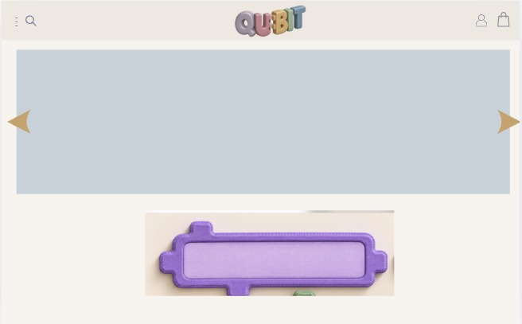
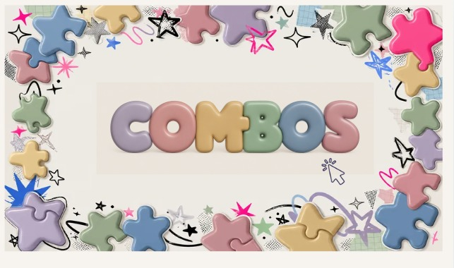
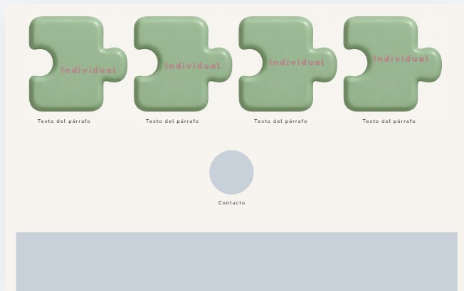
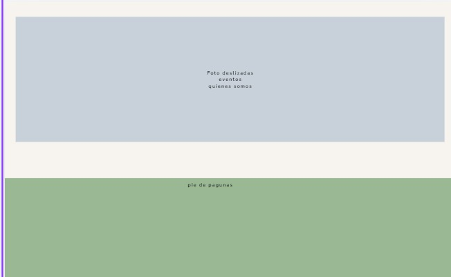
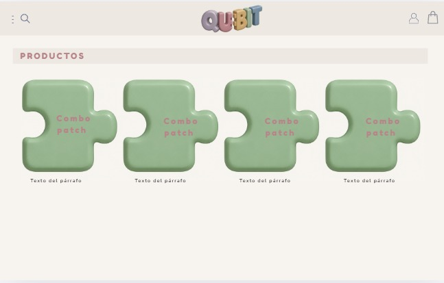
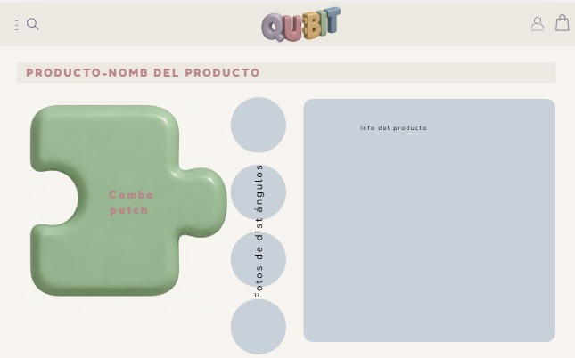
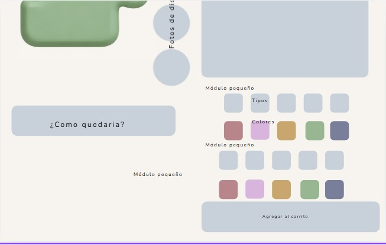
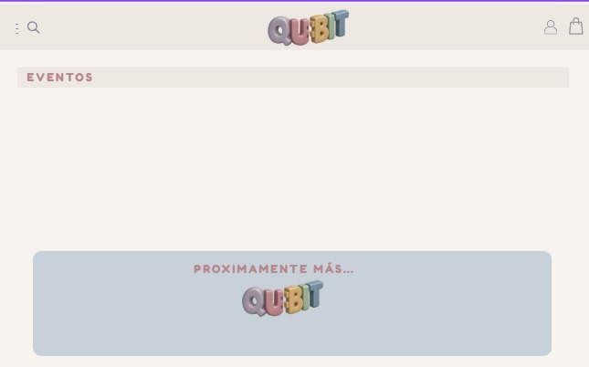

# 🧩 Documento de Diseño y Especificación Visual - QUBIT

Este documento detalla la estructura, flujo de navegación, componentes visuales y especificaciones técnicas para el desarrollo del catálogo web interactivo en **React** para **QUBIT**.

---

## 1. Identidad Visual y Sistema de Diseño (Design System)

### Concepto y Estilo
- **Estética general**: Lúdica, modular, táctil y amigable (estilo *claymorphism* / piezas acolchadas / parches de rompecabezas tipo *foam* o cerámica suave).
- **Formas clave**: Bordes muy redondeados (`rounded-2xl`, `rounded-3xl`, `rounded-full`), siluetas en forma de piezas de rompecabezas (*puzzle pieces*) y botones estilo píldora.
- **Tipografía**: Redondeada, limpia y moderna (por ejemplo: *Nunito*, *Quicksand* o *Fredoka*).

### Paleta de Colores Principal
- **Fondo General**: Crema / Marfil suave cálido (`#FAF6F0` o `#FDFBF7`).
- **Logo QUBIT (3D Pastel)**:
  - **Q**: Lavanda / Lila (`#A594C9`)
  - **U**: Rosa coral / Terracota suave (`#E2847A`)
  - **B**: Ocre / Mostaza pastel (`#E5B25D`)
  - **I**: Verde salvia (`#7CA682`)
  - **T**: Azul grisáceo (`#6E94B2`)
- **Contenedores de Contenido / Sliders**: Azul grisáceo pastel muy suave (`#C8D7E3` / `#D5E0EB`).
- **Piezas de Producto Base**: Verde salvia suave (`#8EAE8D` / `#94B495`) con texto contrastante en rosa empolvado (`#C96876`).
- **Barra de Sección / Títulos**: Fondo rosa empolvado claro (`#F6ECE8`) con texto en bordó/café suave (`#8A5665`).
- **Footer**: Verde salvia apagado (`#8EAE8D`).
- **Paleta de Variantes de Color (Selectores)**:
  - Rosa / Terracota (`#B86B77`)
  - Lila / Violeta pastel (`#CFA0D6`)
  - Mostaza / Ocre (`#CFA04E`)
  - Verde salvia (`#8EA77B`)
  - Azul pizarra (`#667493`)

---

## 2. Componentes Globales (Presentes en Toda la App)

### A. Barra Superior de Navegación (`Header / Navbar`)
Presente en todas las páginas para dar consistencia y permitir el flujo de navegación:
- **Lateral Izquierdo**:
  - Menú hamburguesa (o tres puntos verticales) que despliega menú lateral (*drawer*) con enlaces: *Inicio*, *Combos*, *Eventos*, *Contacto*.
  - Icono de lupa (Buscador rápido).
- **Centro**:
  - Logotipo interactivo **QUBIT** en 3D (al hacer clic redirige a `/`).
- **Lateral Derecho**:
  - Icono de perfil de usuario (`Usuario`).
  - Icono de bolsa de compras (`Carrito`) con indicador de cantidad de items añadidos.

### B. Barra de Título de Página (`SubHeader Banner`)
Presente en páginas interiores (`/combos`, `/combos/:id`, `/eventos`):
- Banda horizontal en fondo crema/rosado con texto en mayúsculas espaciadas (ej: `PRODUCTOS`, `EVENTOS`, `PRODUCTO - [NOMBRE]`).

### C. Pie de Página (`Footer`)
- Franja inferior en verde salvia con enlaces de navegación, redes sociales, créditos y derechos reservados.

---

## 3. Detalle de Rutas y Pantallas

---

### Ruta 1: Página Principal (`/`) - Index

La página principal actúa como vitrina de presentación de la marca, acceso a promociones, catálogo individual y eventos.

#### Secciones de la Página:

1. **Header Global**: Navegación principal.
2. **Hero Slider Principal**:
   - Carrusel ancho con fondo celeste agrisado para promociones o lanzamientos.
   - Controles de navegación laterales (flechas doradas izquierda/derecha).
3. **Módulo de Código de Giftcard (Redirección Automática)**:
   - Campo de entrada / botón interactivo con silueta de pieza de rompecabezas en tono violeta/lila (`#8B68BA`).
   - **Lógica de Redirección Automática**:
     - Permite ingresar un código de tarjeta de regalo (Giftcard) y, al ingresarlo / presionar *Enter* o el botón de canje, redirige automáticamente a la página de detalle del combo asignado a ese código:
       - Código `GIFT1` (o `COMBO1`) ➔ Redirige a `/combos/1`
       - Código `GIFT2` (o `COMBO2`) ➔ Redirige a `/combos/2`
       - Código `GIFT3` (o `COMBO3`) ➔ Redirige a `/combos/3`
       - Código `GIFT4` (o `COMBO4`) ➔ Redirige a `/combos/4`
     - Si se introduce un código incorrecto, muestra un aviso amigable ("Código inválido").



4. **Banner Clickeable "COMBOS"**:
   - Gran banner visual enmarcado con estrellas, trazos doodles e ilustraciones de piezas de rompecabezas de colores.
   - Tipografía central 3D inflable **"COMBOS"**.
   - Incluye cursor/indicador visual que señala que es clickeable.
   - **Acción**: Al hacer clic, navega a la ruta de catálogo de combos: `/combos`.



5. **Catálogo de Productos Individuales**:
   - Sección con **5 tarjetas (cards) normales de producto** (no tienen silueta de rompecabezas, sino formato estándar de card con bordes suaves).
   - Cada card incluye:
     - Imagen rectangular del producto individual.
     - Título del producto (nombre descriptivo).
   - **Comportamiento**: Por ahora son únicamente de exhibición visual (**no redirigen a ningún lado**).
6. **Botón de Contacto**:
   - Botón circular celeste centrado debajo de la grilla de productos individuales.
   - Al hacer clic abre un modal o despliega información de contacto/soporte.



7. **Sección de Imagen Grande: Eventos & "Quiénes Somos"**:
   - En lugar de un slider, es una **imagen grande destacada** (banner amplio con bordes redondeados) que muestra las fotografías de eventos, ferias y la historia de la marca ("Quiénes Somos").
8. **Pie de Página (Footer)**:
   - Franja verde salvia que cierra la página.



---

### Ruta 2: Catálogo de Combos (`/combos`)

Espacio dedicado a mostrar los packs/combos modulares disponibles para armar o comprar en conjunto.

#### Elementos de la Página:
- **Header Global**: Barra superior con logo, buscador y carrito.
- **Banner de Sección**: Barra superior con título `PRODUCTOS`.
- **Buscador / Filtros**: Barra de búsqueda para filtrar combos por nombre o estilo.
- **Grilla de Combos**:
  - 4 tarjetas principales de producto con imagen ("Combo patch").
  - Cada tarjeta incluye título, breve descripción ("Texto del párrafo") y precio estimado.
  - **Acción interactiva**: Cada card es clickeable y lleva a la vista individual de ese combo: `/combos/:id`.



---

### Ruta 3: Detalle de Producto Combo (`/combos/:id`)

Página interactiva para configurar y personalizar las piezas que componen el combo antes de agregarlo al carrito.

#### Estructura en 2 Columnas (Layout Dividido):

#### 1. Columna Izquierda (Galería & Previsualizador):
- **Vista Principal**:
  - Imagen en gran tamaño de la pieza del combo seleccionada ("Combo patch").
- **Columna de Ángulos / Miniaturas**:
  - 4 botones circulares verticales ("Fotos de dist ángulos") para alternar la vista (frente, lateral, ensamble, perspectiva).
- **Botón "¿Cómo quedaría?"**:
  - Botón alargado redondeado que abre una vista previa interactiva o modal de simulación (ver cómo encajan las piezas juntas en un espacio).



#### 2. Columna Derecha (Información & Personalizador Modular):
- **Caja de Información del Producto**:
  - Bloque celeste redondeado con título, descripción técnica, dimensiones, materiales y precio.
- **Configurador de Módulos (Selectores de Tipo y Color)**:
  - **Módulo 1**:
    - **Tipos**: Fila de 5 variantes/formas de pieza (botones cuadrados redondeados).
    - **Colores**: Fila de 5 círculos/muestras de color (rosa, lila, mostaza, verde, azul pizarra) con estado activo/seleccionado.
  - **Módulo 2 (Módulo pequeño / complementario)**:
    - Fila de variantes de tipo.
    - Fila de variantes de color para el segundo módulo.
- **Botón de Acción Principal**:
  - Botón ancho redondeado: **"Agregar al carrito"**.
  - Al presionarlo, actualiza el estado del carrito en el Header y muestra notificación visual de éxito.



---

### Ruta 4: Página de Eventos (`/eventos`)

Página de aterrizaje informativa sobre eventos futuros, talleres y ferias donde participa Qubit.

#### Elementos de la Página:
- **Header Global**: Con logo y navegación.
- **Banner de Sección**: Barra con título `EVENTOS`.
- **Card Central de "Próximamente"**:
  - Gran tarjeta redondeada celeste.
  - Mensaje destacado en color terracota: **"PRÓXIMAMENTE MÁS..."**.
  - Logo 3D de **QUBIT** centrado como sello de marca.
  - *(Opcional visual)*: Caja para suscribirse con correo electrónico para recibir notificaciones cuando se publiquen las fechas.



---

## 4. Mapa de Navegación y Rutas (React Router)

```
[ / ] (Home / Index)
  ├── [ /combos ] (Catálogo de Combos)
  │     └── [ /combos/:id ] (Detalle y personalizador de combo)
  ├── [ /eventos ] (Página de eventos - Próximamente)
  └── Modales interactivos (Giftcard, Contacto, Vista previa "¿Cómo quedaría?")
```

---

## 5. Arquitectura Técnica Recomendada (React Frontend)

Para una implementación limpia, escalable y visualmente fiel:

### Tecnologías sugeridas:
- **Framework**: React + Vite (rápido y liviano).
- **Enrutamiento**: `react-router-dom` (manejo de rutas `/`, `/combos`, `/combos/:id`, `/eventos`).
- **Estilos**: Tailwind CSS (permite replicar con precisión los radios de borde, sombras suaves, paletas pasteles y layouts responsivos) + CSS puro para las formas personalizadas de rompecabezas.
- **Iconografía**: `lucide-react` (iconos para lupa, menú, carrito, usuario, flechas).

### Estructura de Carpetas Propuesta:
```
qubit/
├── public/
├── src/
│   ├── assets/              # Imágenes de productos, logo Qubit, texturas
│   ├── components/
│   │   ├── layout/
│   │   │   ├── Navbar.jsx   # Header global con carrito
│   │   │   ├── SubHeader.jsx# Barra rosa con título de sección
│   │   │   └── Footer.jsx   # Pie de página verde
│   │   ├── home/
│   │   │   ├── HeroSlider.jsx
│   │   │   ├── GiftCardBar.jsx      # Input interactivo que redirige según código ingresado
│   │   │   ├── CombosBanner.jsx     # Banner navegable a /combos
│   │   │   ├── IndividualGrid.jsx   # Grilla de 5 cards normales de producto (sin enlace)
│   │   │   └── EventsBanner.jsx     # Imagen grande destacada de eventos y quiénes somos
│   │   ├── product/
│   │   │   ├── ProductCard.jsx      # Card normal para productos individuales
│   │   │   ├── PuzzlePieceCard.jsx  # Card en forma de rompecabezas para combos
│   │   │   ├── AngleSelector.jsx
│   │   │   ├── ColorPicker.jsx
│   │   │   └── TypePicker.jsx
│   │   └── ui/
│   │       ├── Modal.jsx
│   │       └── Button.jsx
│   ├── context/
│   │   └── CartContext.jsx   # Manejo de productos en carrito para la demo
│   ├── data/
│   │   ├── products.js       # Mock de productos individuales y combos
│   │   └── events.js         # Mock de fotos de eventos
│   ├── pages/
│   │   ├── HomePage.jsx
│   │   ├── CombosPage.jsx
│   │   ├── ComboDetailPage.jsx
│   │   └── EventsPage.jsx
│   ├── App.jsx
│   └── main.jsx
├── imagenes/                 # Referencias visuales del diseño
└── disenio.md               # Este documento de especificación
```

---

## 6. Siguientes Pasos
1. **Validación del Documento**: Revisar que todos los componentes y flujos reflejen fielmente tu idea.
2. **Inicialización del Proyecto**: Configurar la aplicación React (Vite + Tailwind CSS + React Router).
3. **Corte y Extracción de Assets**: Preparar los recursos gráficos (logo Qubit, formas de rompecabezas y fotos).
4. **Implementación de Rutas y Componentes Visuales**: Armado de la interfaz navegable y sus interacciones.
